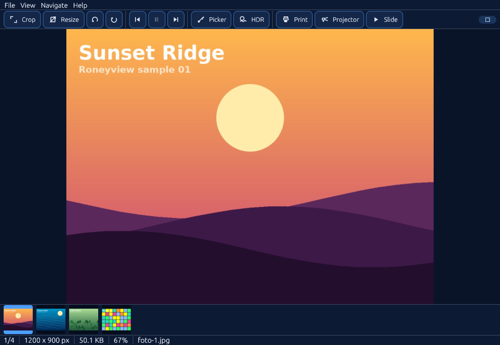
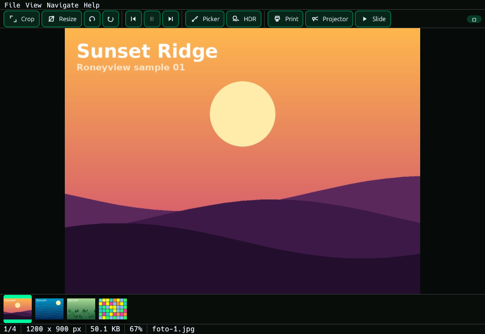
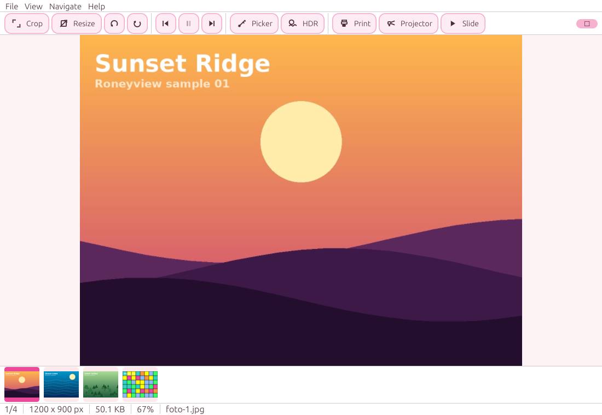
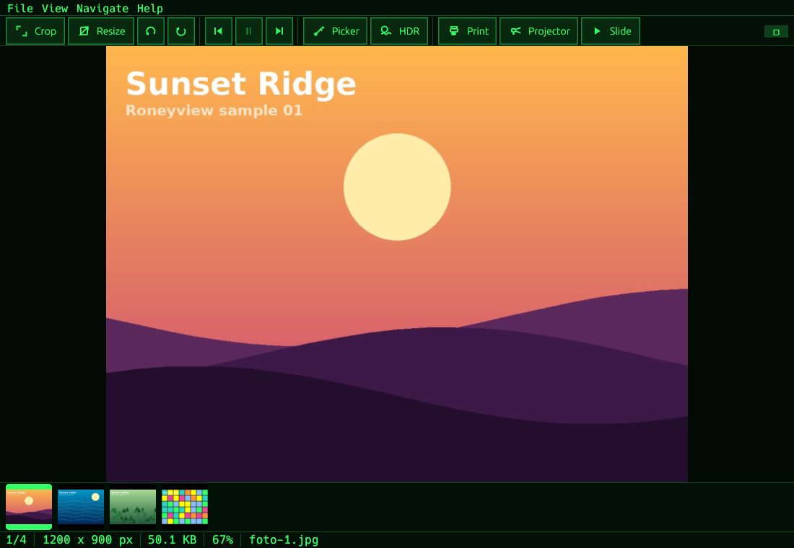

# Roneyview (version 0.8.31)
###### README.md berbahasa Inggris ada [di sini](README.md)

Alternatif Honeyview; penampil gambar untuk Linux; ditulis dalam bahasa pemrograman Rust (menggunakan egui/eframe).

## Di mana saya bisa mengunduh file Deb atau Flatpak?
Kamu bisa mengunduh di tempat Releases (lokasi di bawah "about" pada repositori github roneyview) atau cukup [klik ini](https://github.com/tengkoru/roneyview/releases) untuk menuju halaman unduhan, gulir lalu klik menu dropdown bernama "Assets".

## Screenshot

<table>
  <tr>
    <td>
      
      <br>DarkNavy theme
    </td>
    <td>
      
      <br>Neon theme (default)
    </td>
  </tr>
  <tr>
    <td>
      
      <br>Sakura theme
    </td>
    <td>
      
      <br>Terminal theme
    </td>
  </tr>
</table>
Tangkapan layar yang lain [klik disini]("tests/").

Pilihan tema lainnya didalam Roneyview diperlihatkan di [klik disini](tests/03-settings-tema-en.png).

## Apa yang bisa dilakukan Roneyview?
- **Membuka gambar**, **folder**, dan **arsip**
- **Mendukung format gambar**: JPEG/JPG, PNG, GIF, WebP, BMP, TIFF, QOI, TGA, ICO, AVIF, HEIC/HEIF, HDR (.hdr)
- **Mendukung format gambar animasi**: GIF, WebP, APNG, dan TIFF multi-halaman (satu frame per halaman)
- **Tekan tombol 'P' untuk menjeda/memutar file gambar animasi**; `,` / `.` melangkah satu frame mundur/maju (otomatis menjeda)
- **Mendukung format arsip**: ZIP/CBZ/RAR/CBR; hanya menampilkan file gambar yang ada di dalam arsip
- **Mengingat sampai mana kamu berhenti**: saat kamu membuka folder atau arsip secara langsung, Roneyview membukanya kembali pada
halaman terakhir yang kamu baca (disimpan di `~/.config/roneyview/positions.json`, hingga 200 entri). **Folder terakhir**
hanya diingat jika kamu mengaktifkannya di Pengaturan (mati secara default). Jika kamu menjalankan Roneyview dari
baris perintah tanpa menentukan path file atau folder, ia hanya akan membuka jendela kosong
- **Lompat ke halaman** (`Ctrl+G`) melompat ke halaman mana pun; menu **Navigasi** juga mencantumkan folder terakhir (bila diaktifkan)
- **Klik kanan pada gambar menampilkan menu berikut**:
    - **Jadikan wallpaper...**
    - **Properti**
    - **Aksi**:
        - Buka folder asalnya
        - Pindahkan ke sampah
        - Simpan halaman sebagai gambar... (menyimpan byte asli dari halaman)
        - Untuk animasi: Simpan frame ini sebagai gambar... dan Ekspor semua frame... (sebagai PNG)
- **Toolbar** (tersembunyi secara default, menu View): tombol khusus ikon untuk **Crop**, **Resize**,
**navigasi Frame**, **Color picker**, **HDR tone mapper**, **Print / simpan sebagai PDF**, dan **Projector** —
lihat [Toolbar dan pengeditan sederhana](##toolbar-and-simple-editing) di bawah
- **Tentang** (menu Help): jendela berjudul versi, kredit pengembang, dan library yang digunakan
- **Mode dua halaman** dan **arah baca kanan-ke-kiri** untuk manga/komik
- **Pengaturan mode tampilan** : mode Window-fit, width-fit, height-fit, dan 100%; zoom ke kursor, pan, rotate, dan layar penuh
- **Tombol Sebelumnya/Berikutnya di tepi kiri/kanan**; hanya muncul saat penunjuk mendekati tepi
- **Bilah bawah**:
    - **tombol sebelum/berikut**
    - **slider seek**
    - **kotak centang 'lock' agar 'bilah bawah' tetap terlihat**
    
## Debian/Ubuntu/MX Linux/turunan Debian lainnya

#### 1. Alat build + library untuk dialog file (GTK3) dan AVIF/HEIC (libheif)
```bash
sudo apt update
sudo apt install build-essential pkg-config libgtk-3-dev libheif-dev curl
```
#### 2. Rust terbaru (paket rustc di Debian terlalu tua; membutuhkan Rust >= 1.88)
```bash
curl --proto '=https' --tlsv1.2 -sSf https://sh.rustup.rs | sh
source "$HOME/.cargo/env"
```
#### 3. Kompilasi dan instal ke ~/.local (tanpa sudo)
```bash
./install.sh
```
Semua dependensi yang dibutuhkan agar roneyview berjalan lancar akan diunduh otomatis saat kamu menjalankan ./install.sh.
Namun, jika kamu ingin melihat dependensi apa saja yang dibutuhkan Roneyview, kamu bisa melihatnya di Cargo.lock.

`install.sh` memeriksa paket yang tersedia dan hanya mengaktifkan fitur yang bisa di-build,
lalu menampilkan fitur mana yang dilewati beserta perintah `apt` untuk menginstalnya.
`./install.sh --dry-run` hanya menampilkan opsi-opsi ini tanpa mengkompilasi.

| Fitur | Kebutuhan saat build | Catatan |
|---|---|---|
| `dialogs` (dialog Buka file) | `libgtk-3-dev` | drag-and-drop dan argumen baris perintah tetap berfungsi tanpanya |
| `heif` (AVIF, HEIC/HEIF) | `libheif-dev` **>= 1.17** | lihat catatan versi di bawah |
| `rar` (RAR/CBR) | `g++` (dari `build-essential`) | kode unrar otomatis dikompilasi oleh Cargo |

Setelah terinstal, `roneyview` tersedia di terminal (pastikan `~/.local/bin` ada di `PATH` kamu)
dan muncul di menu aplikasi serta opsi "Open with" di file manager.
Hapus dengan `./install.sh --uninstall`.

### Catatan versi libheif (AVIF/HEIC)

- **MX Linux 25 / Debian 13**: libheif 1.19; didukung. Jika file HEIC atau AVIF gagal dibuka dengan
galat "decoder", instal plugin codec: `sudo apt install libheif-plugin-libde265 libheif-plugin-dav1d`.
- **MX Linux 23 / Debian 12**: libheif hanya versi 1.15, yang **terlalu tua** untuk crate yang dipakai
(butuh >= 1.17). `install.sh` otomatis melewati fitur ini; semua fitur lain tetap berfungsi.
- Build manual tanpa fitur tertentu, cth.: `cargo build --release --locked --no-default-features --features dialogs,rar`

### Catatan RAR

File RAR hanya bisa dibaca berurutan (tanpa akses acak). Roneyview mengingat posisi baca di dalam arsip selama arsip terbuka,
jadi membuka halaman berikutnya cepat, tetapi melompat mundur akan membuka ulang arsip dari awal. Pada arsip *solid*
berukuran besar, lompatan jauh mungkin terasa lambat. **Arsip berpassword tidak didukung.**

## Pintasan

| Tombol | Fungsi |
|---|---|
| Kanan / PgDn / Spasi | Gambar berikutnya |
| Kiri / PgUp / Backspace | Gambar sebelumnya |
| Home / End | Pertama / terakhir |
| Roda mouse | Gulir vertikal; ganti gambar saat di tepi |
| Atas / Bawah, drag klik-kiri | Geser gambar |
| Ctrl + roda, `+`, `-` | Zoom |
| `F` / `Shift+F` | Paskan ke jendela (hanya susutkan / susutkan & perbesar) |
| `W` / `H` | Paskan ke lebar / tinggi |
| `0` atau `1` | Ukuran asli (100%) |
| `R` / `Shift+R` | Putar kanan / kiri |
| `P` | Jeda / putar animasi |
| `,` / `.` | Frame animasi sebelum / berikut (otomatis jeda) |
| `Ctrl+G` | Lompat ke halaman... |
| `Ctrl+,` | Pengaturan |
| `T` | Sembunyikan/tampilkan Toolbar [default: **tampil**]|
| `L` | Kunci / buka bilah bawah |
| `M` | Mode hemat memori |
| Enter, F11, klik ganda | Layar penuh (Esc untuk keluar) |
| Ctrl+O / Ctrl+Shift+O | Buka file atau arsip / buka folder |
| F1 | Daftar pintasan |
| Ctrl+Q | Keluar |

## Penggunaan baris perintah
Lebih suka memakai baris perintah daripada klik-ganda file di file manager? jangan khawatir, kami menyediakan opsi itu di sini:
```bash
roneyview photo.jpg        # buka foto; seluruh folder ikut dimuat
roneyview ~/Comic_title/Chapter1    # buka folder
roneyview title_comic.cbz       # buka arsip (juga .zip, .rar, .cbr)
roneyview                 # jendela kosong; Ctrl+O untuk membuka gambar
roneyview --version		#  Lihat versi roneyview yang kamu pakai sekarang
```

### Atur wallpaper memakai baris perintah roneyview
```bash
roneyview --set-wallpaper photo.jpg --style zoomed --color '#202020'   # tanpa membuka jendela
roneyview --restore-wallpaper                                          # kembalikan wallpaper root window
```

Semua pengaturan disimpan di `~/.config/roneyview/state.json` (mode zoom, kunci bilah, mode hemat memori,
tata letak dua halaman, arah baca, bahasa, visibilitas toolbar, dan opsi terakhir di jendela wallpaper;
folder terakhir hanya bila diaktifkan di Pengaturan). **Posisi terakhir dibaca** dari tiap folder/arsip disimpan
terpisah di `~/.config/roneyview/positions.json` (hingga 200 entri) dan dipulihkan saat kamu membuka folder/arsip itu
langsung.

## Mode hemat memori (tombol `M` atau via menu view)

**Hanya gambar yang sedang dilihat** yang disimpan di RAM; gambar sebelumnya dibuang segera setelah kamu berpindah,
dan tidak ada prefetching.

## Menu klik-kanan

Klik-kanan pada gambar (dalam mode dua halaman: pada halaman yang diklik):

- **Jadikan wallpaper...** membuka jendela baru dengan pratinjau langsung,
**Warna** (**Warna solid** dengan color picker + kolom hex di sebelahnya, atau **Transparan**) dan **Gaya**
(*None, Centered, Tiled, Stretched, Scaled, Zoomed*), diikuti tombol **Terapkan**. Gambar dari ZIP/RAR atau format
yang tak dikenali desktop (HEIC, AVIF, WebP, ...) otomatis diekspor ke PNG sementara.
- **Properti** menampilkan nama file, lokasi, dimensi gambar, ukuran file, format, dan tanggal modifikasi. Untuk
gambar di dalam arsip: path arsip dan path di dalam arsip.
- **Aksi**: 
	- **Buka di folder** (membuka file manager dan memilih file)
	- **Pindahkan ke sampah**
(dengan konfirmasi; mengikuti spesifikasi Sampah freedesktop.org). Jika gambar ada di dalam arsip, kedua
opsi hanya menampilkan peringatan, dan Roneyview tidak melakukan tindakan lebih lanjut.

### Atur wallpaper di berbagai desktop

Tidak ada satu metode yang bekerja di semua lingkungan desktop, karena tiap lingkungan desktop mengelola background-nya
sendiri. Roneyview mendeteksi desktop yang berjalan dan memakai mekanisme resminya:

| Desktop | Metode | Status pengujian |
|---|---|---|
| Xfce | `xfconf-query` (properti xfce4-desktop) | diuji dengan xfdesktop 4.18 asli |
| Window manager tanpa desktop manager (Fluxbox, Openbox, i3, ...) | menggambar langsung ke root window X11 (semua gaya, dukungan multi-monitor via RandR) + autostart `roneyview --restore-wallpaper` | diuji di Xvfb |
| GNOME, Budgie, Unity | `gsettings` (`org.gnome.desktop.background`) | kunci dan nilai divalidasi terhadap skema aslinya |
| Cinnamon | `gsettings` (`org.cinnamon.desktop.background`) | divalidasi terhadap skema aslinya |
| MATE | `gsettings` (`org.mate.background`) | divalidasi terhadap skema aslinya |
| KDE Plasma | skrip Plasma via D-Bus (`gdbus`) | **belum diuji di Plasma**; hanya baris perintah yang diperiksa |
| LXDE / LXQt | `pcmanfm --set-wallpaper` / `pcmanfm-qt` | **belum diuji**; hanya baris perintah yang diperiksa |
| Sway | `swaymsg output * bg` | **belum diuji**; hanya baris perintah yang diperiksa |
| Lingkungan Wayland lain, GNOME/KDE tanpa perintah di atas | tidak didukung | pesan jelas ditampilkan di jendela |

Catatan: *Transparent* hanya bermakna di Xfce; hitam dipakai di desktop lain.

## Mode dua halaman dan arah baca

- `D` mengaktifkan/menonaktifkan **mode dua halaman**; `K` mengganti **arah baca** antara kiri-ke-kanan dan kanan-ke-kiri (manga).
- Menu View juga menyertakan **Halaman pertama tunggal (sampul)**: halaman pertama ditampilkan sendiri, diikuti pasangan
2-3, 4-5, ...
- Halaman **lebar** (lanskap, cth. pindaian dua halaman) selalu ditampilkan sendiri; tinggi kedua halaman disamakan. - Dalam mode kanan-ke-kiri, halaman pertama ada di kanan; **panah kiri = berikutnya**, dan tombol sisi, bilah,
dan slider dicerminkan. `Space`/`PgDn` tetap berarti "berikutnya."
- Rotasi (`R`) tidak tersedia dalam mode dua halaman.

## Alat edit sederhana di Toolbar (T)

Toolbar berada di bawah menu utama dan tersembunyi secara default; tampilkan dari menu View
(atau sembunyikan lagi dengan tombol X di ujung kanannya). Tombol-tombolnya khusus ikon:

- **Crop gambar**: gambar seleksi langsung di foto, pilih rasio aspek (Free, 1:1, 4:3, 3:2,
16:9, 2:3, 3:4, 9:16), sesuaikan posisi dan ukurannya, lalu crop, salin, atau simpan hasilnya.
- **Resize gambar**: ubah ukuran berdasarkan piksel atau persen, kunci proporsinya, pilih metode resampling
(Nearest, Triangle, CatmullRom, Lanczos3, Gaussian), dan lihat ukuran baru sebelum diterapkan.
- **Navigasi frame**: frame sebelum, jeda/putar, frame berikut (juga `,` / `.` dan `P`).
- **Color picker**: perbesar dan ambil sampel piksel mana pun untuk membaca nilainya dalam RGBA, HEX, HSL, HSV, CMYK,
atau CIELAB, tepat di atas gambar.
- **HDR tone mapper**: tone-map gambar HDR untuk layar standar, dengan kontrol langsung atas exposure,
reference white, kompresi highlight, dan saturasi.
- **Print, simpan sebagai PDF**: cetak ke printer mana pun atau simpan sebagai PDF, dengan tata letak dari satu halaman penuh
hingga contact sheet (2×2, 3×3, 4×4) dan pratinjau langsung tiap halaman.
- **Projector**: presentasi di layar lain selagi kamu menjelajah dari jendela utama.

Pengeditan membuka gambar pada resolusi penuh dalam tampilan edit (Esc atau Cancel membuang perubahan;
Save menulis PNG). Alat crop, resize, color picker, dan tone mapper hanya bekerja pada gambar yang
**tidak** ada di dalam arsip; **untuk mengedit gambar dari arsip**, simpan dulu
(Save page as image...), lalu buka file yang disimpan. Print / simpan sebagai PDF dan projector juga bekerja pada
file arsip.

## Batasan animasi

Semua frame animasi disimpan di memori. (maks. kira-kira 128 MB per animasi, 1500 frame).
Animasi yang lebih besar dipotong, dan bilah status menampilkan "truncated". File TIFF multi-halaman
diperlakukan sebagai animasi (satu frame per halaman).

## Pengembangan

```bash
cargo test            # unit test: urutan natural, ZIP/RAR, GIF animasi, TIFF multi-halaman, HEIC/AVIF, anggaran memori, slider, zoom,
# tata letak wallpaper, deteksi desktop, perintah gsettings/KDE/pcmanfm/sway, tampilan dua halaman, posisi terakhir dibaca,
# konversi warna, matematika crop/resize, tone mapping HDR, pembuatan PDF minimal
cargo run -- /path/to/image
```
